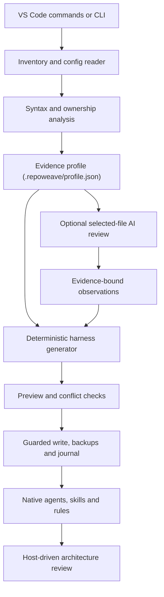

# RepoWeave — Agent Harness Studio

Generate a repository-aware, multi-agent harness for Angular and React projects, from a VS Code extension or a portable Node command-line kit.

*By Roshan Mali*

Version 0.1.2 is a working local preview. It has not been published to the Visual Studio Marketplace.

## Quick start

1. Install the `.vsix` (Extensions view → `...` → **Install from VSIX…**), then reload the window.
2. Open an Angular or React project and trust the workspace.
3. Press **Ctrl+Shift+P** and run **RepoWeave: Generate Harness (All Steps)**. It analyzes the repository, shows the planned files, asks once before writing, applies them and validates the result.

Prefer to go step by step? Click **RepoWeave** in the status bar. The studio highlights the next action: analyze, preview, apply, then copy the architecture prompt. The status bar names that same step.

## Overview

Coding assistants such as GitHub Copilot, Claude Code and Codex work better when they are given accurate, project-specific context: which frameworks and versions are in use, how the workspace is split into projects, how components, services and routes are organized, which styling and test tools exist, and which existing team instructions must be respected. Writing and maintaining that context by hand is tedious, and generic templates often prescribe conventions the project does not follow.

RepoWeave analyzes a repository locally and records what it finds in an evidence profile. From that profile it deterministically generates a complete baseline harness of agents, skills, scoped rules, task prompts and shared context files for the coding hosts you select. Every write goes through a preview, conflict detection and a guarded, journaled apply step, so existing instructions and hand-edited files are never silently overwritten.

RepoWeave is deliberately honest about what static analysis can establish. Business behavior, team precedence and real data flows still need a semantic review. For that step, RepoWeave generates a bootstrap workflow and a harness-builder agent. The agent writes `.repoweave/semantic.json`; you then rerun Preview. RepoWeave never writes that file. It does not run a background service or autonomous model workers.

## Features

- **Static repository analysis.** RepoWeave inventories first-party files, nested package manifests, Angular workspace and Nx project roots, JSONC configuration and local `tsconfig` inheritance. It resolves framework versions from npm (`package-lock.json`) and pnpm (`pnpm-lock.yaml`) lockfiles.
- **TypeScript AST signals.** The TypeScript compiler API is used to parse JavaScript and TypeScript sources for imports, dynamic imports, Angular `@Component`, `@NgModule` and `@Injectable` metadata (including standalone flags and `providedIn` scope), bootstrap calls, lazy route signals (`loadComponent`, `loadChildren`), React hooks and `'use client'` directives.
- **Per-project ownership.** Each source file belongs to the longest matching project root, so mixed and nested Angular/React projects keep separate profiles. Relative imports and local tsconfig `paths` / `baseUrl` aliases resolve into import edges. An alias with no local file stays unresolved. Package-based tsconfig `extends` is not followed.
- **Routes and main files.** Angular route objects (`path` with `loadComponent`, `loadChildren`, `component` or `redirectTo`), React Router `<Route>` entries and Next `app/` or `pages/` files are recorded with evidence and confidence. Entry, root-route, app-config and most-imported files are identified the same way.
- **No execution of project code.** Analysis never runs npm scripts, imported configuration modules, tests, Git checkouts or remote writes. Scripts are recorded as argument-array descriptors marked `not-run`, and their shell bodies are not copied into instructions.
- **Deterministic generation.** The same profile and options always produce the same files, for one or more of Copilot, Claude Code and Codex, using each host's native agent and skill formats.
- **Safe write model.** Preview with per-file diffs, hash-based conflict detection, managed blocks in root instruction files, backups, a transaction journal, a write lock and rollback on failure.
- **Optional AI review.** Selected files can be sent, after you review the redacted payload, to a model exposed through the VS Code Language Model API. Observations must cite the selected files and stay labeled as unverified suggestions.
- **Optional tracker connection.** The studio asks you to connect Azure DevOps or Jira, or to continue from pasted or local requirements. Azure or Jira adds the tracker specialist so agents can fetch the work item before planning. Figma, requested with `--integrations figma` or detected from a filename hint, adds the design reviewer. RepoWeave does not sign in, store tokens, or call the tracker API.
- **Optional freshness hook.** A read-only SessionStart hook can warn when tracked configuration has changed since the profile was generated.

## How it works



1. **Analyze.** RepoWeave builds a file inventory (using `git ls-files` when Git is available, otherwise a filesystem walk that applies nested `.gitignore` rules), reads configuration and parses source syntax.
2. **Profile.** Findings are stored as an evidence profile with file paths, line numbers, coverage counts, omitted files and explicit unknowns.
3. **Preview.** The generator produces the harness in memory. The writer compares each proposed file with what is on disk and the previous manifest, and marks each one as `create`, `update`, `unchanged` or `conflict`.
4. **Apply.** If there are no conflicts and nothing has changed since the preview, the planned files are written.
5. **Review.** Your coding host runs the generated harness-builder agent. It writes `.repoweave/semantic.json`. Rerun Preview so feature agents and the remaining facts are regenerated from that file.

The analysis stages and what each one can and cannot establish:

| Stage | What it does | What it cannot establish alone |
|---|---|---|
| Static scan | File inventory, nested manifests, npm/pnpm resolved framework versions, JSONC and local tsconfig inheritance, path aliases, Angular and React/Next route entries, main files, decorator metadata, provider scopes, styles and tooling | Business behavior, library precedence, whether every route really loads lazily, complete API data flow |
| Optional AI review | Sends explicitly selected and reviewed files to a model exposed through VS Code and accepts only observations with valid evidence paths | Whole-repository understanding from a small sample, or guaranteed correct findings |
| Host architecture review | The generated harness-builder agent and bootstrap skill guide the coding assistant through all first-party areas. Findings go into `.repoweave/semantic.json`, which RepoWeave only reads | Automatic certification; findings still need project validation |

## Supported targets

Shared context always lives under `.repoweave/`. Each selected host additionally receives native files:

| Target | Agents | Skills (single target) | Rules and instructions |
|---|---|---|---|
| GitHub Copilot | `.github/agents/{prefix}-*.agent.md` | `.github/skills/{prefix}-*/SKILL.md` | `.github/copilot-instructions.md` and scoped `.github/instructions/{prefix}-*.instructions.md`; prompt files in `.github/prompts/{prefix}-*.prompt.md` |
| Claude Code | `.claude/agents/{prefix}-*.md` | `.claude/skills/{prefix}-*/SKILL.md` | `CLAUDE.md` and scoped `.claude/rules/{prefix}-*.md` with a `paths` list |
| Codex | `.codex/agents/{prefix}-*.toml` | `.agents/skills/{prefix}-*/SKILL.md` | `AGENTS.md`, which links the shared context; per-project rules are linked from `.repoweave/architecture.md`. No files are written inside application directories. |

`{prefix}` comes from the root `package.json` `name` (scope stripped, kebab-case, safe characters, at most 40 characters), otherwise the folder name, otherwise `project`. Override it with `--prefix` or `repoweave.agentPrefix`. An empty setting derives the prefix. A value that would make an unsafe path is rejected. Files from an earlier `rw-*` harness are retained, not deleted.

When more than one target is selected, skills are written to a single shared location to avoid duplicate names: `.agents/skills/` if Codex is among the targets, otherwise `.claude/skills/`. Each root instruction file links those skill files explicitly. Some clients do not automatically discover another client's skill directory, so in that case follow the linked files. For the cleanest native discovery, select only the host you actively use.

The root instruction files (`.github/copilot-instructions.md`, `CLAUDE.md`, `AGENTS.md`) receive only a small block between `<!-- repoweave:start -->` and `<!-- repoweave:end -->` markers. Text outside that block is preserved.

The shared `.repoweave/` folder contains:

- `profile.json`, the evidence profile, and `architecture.md`, a readable architecture evidence report.
- `commands.json`, a catalog of project scripts as descriptors that analysis never runs.
- `rules/<project-id>.md`, per-project rules derived from the profile.
- `harness.md`, `scan-contract.md`, `BOOTSTRAP.md` and `integrations.md`, the delivery harness, discovery contract, bootstrap workflow and MCP onboarding guide.
- `catalog.md`, `SETUP.md` and `integration-status.json`.
- `semantic.schema.json` and `semantic.example.json`. `semantic.json` is yours; Preview and Apply never create or replace it, and it is not listed in the manifest.
- `prompts/*.md`, plain task prompts for hosts that do not load Copilot prompt files.
- `ai-observations.json`, only when an AI review was run.
- `scripts/freshness.cjs`, only when hooks are enabled.
- `manifest.json` and `backups/`, written by Apply.

## Generated agents and skills

Names below use `{prefix}`. These agents are always generated. The orchestrator lists exactly this set, plus any conditional agents that were actually emitted.

| Agent | Purpose | Tool access |
|---|---|---|
| `{prefix}-orchestrator` | Coordinates scoped delivery and evidence-based handoffs | Full; can delegate to the other generated agents on Copilot |
| `{prefix}-planner` | Plans a feature against repository architecture | Read-only |
| `{prefix}-researcher` | Maps architecture and resolves dependency questions. Starts a defect investigation | Read-only |
| `{prefix}-implementer` | Implements scoped application changes following local patterns | Full |
| `{prefix}-ui-specialist` | Implements scoped styling and responsive behavior | Full |
| `{prefix}-test-generator` | Creates missing behavior-focused tests | Full |
| `{prefix}-test-fixer` | Repairs existing tests from observed failures | Full |
| `{prefix}-reviewer` | Reviews a working-tree diff or a pull request. Does not merge | Read-only |
| `{prefix}-harness-builder` | Records the semantic review in `.repoweave/semantic.json` | Full |

A defect follows researcher, then implementer or test-fixer, then reviewer. There is no defect-analyst agent and no separate pull-request agent.

| Agent | Added when | Purpose |
|---|---|---|
| `{prefix}-integration-specialist` | Azure DevOps or Jira is requested | Fetches the work item before planning, through the host's existing MCP connection |
| `{prefix}-design-reviewer` | Figma is requested or a Figma hint is detected | Compares an implementation against a supplied design (read-only) |
| `{prefix}-a11y-label-fixer` | Sonar is detected | Fixes inputs that lack an accessible label |
| `{prefix}-feature-{slug}` | One entry in `.repoweave/semantic.json` `domains` | Specialist for that feature |

Read-only roles drop edit and execute tools. On Claude those roles receive Read, Glob and Grep. On Codex they request a read-only sandbox. Enforcement belongs to the host. No model is pinned.

Skills are rendered from `resources/templates/skills/`. The design-compliance skill is included only with the design reviewer. The others are always included: architecture discovery, bootstrap, deliver, design document, MCP onboard, missing tests, quality review, scaffold, system refresh, test run and test triage.

Task prompts cover planning, delivery, missing tests, failing tests, change review, a codebase audit, a design document and the semantic review. Bodies come from the templates, not from a role catalog.

## Installation

RepoWeave is distributed as a VSIX file for local installation. It requires VS Code 1.99 or later.

1. Obtain `repoweave-0.1.2.vsix` from the release bundle, or build it from source with `npm run package` (see [Development](#development)).
2. In VS Code, run **Extensions: Install from VSIX...** from the Command Palette and select the file.
3. Open your application repository and make sure the workspace is trusted.

No project dependency installation is needed to use the VSIX, because the extension bundles its scanner libraries. Node.js on `PATH` is needed only for the optional freshness hook and the standalone CLI.

The publisher id is `roshanmali`. The extension has not been published to the Marketplace yet.

## Usage in VS Code

1. Run **RepoWeave: Open Harness Studio**, click **RepoWeave** in the status bar, or right-click the repository root in the Explorer.
2. Follow the highlighted step. On a first run that step is **Generate harness (all steps)**. It analyzes the repository, lists the proposed files, and writes them after one confirmation.
3. To go one step at a time, choose **Analyze**, then **Preview**. Click any proposed file in the studio to open a before/after diff, then **Apply preview**.
4. Choose the coding assistant with **Change assistants** (GitHub Copilot, Claude Code, Codex, or several). Preview again after changing it.
5. After the files are written, choose **Copy architecture prompt** and paste it into your coding assistant. After it writes `.repoweave/semantic.json`, run Preview again.

The status bar shows the same next step when the studio is closed: Start, Preview, Apply, a conflict count, or Review. Apply stays unavailable until a preview has changes and no conflicts. Conflicts are listed in the studio and are never overwritten.

If the custom agent list does not refresh after Apply, reload the coding client.

A first-run walkthrough, **Create an agent harness**, is included for the Get Started page.

All commands are also available from the Command Palette:

| Command | Description |
|---|---|
| **RepoWeave: Open Harness Studio** | Opens the studio. The highlighted card is the next step, and proposed files open as diffs |
| **RepoWeave: Generate Harness (All Steps)** | Analyzes the repository, shows the preview, and writes it after one confirmation, then validates |
| **RepoWeave: Analyze Repository** | Scans the repository and opens the architecture evidence report |
| **RepoWeave: Preview Harness** | Generates the harness in memory and shows proposed changes and diffs |
| **RepoWeave: Apply Previewed Harness** | Writes the reviewed preview after a confirmation dialog |
| **RepoWeave: Analyze Selected Files with AI** | Sends selected, reviewed files to a VS Code language model for evidence-bound observations |
| **RepoWeave: Copy Architecture Review Prompt** | Copies a prompt that starts the bootstrap architecture review in your coding host |
| **RepoWeave: Validate Installed Harness** | Checks installed files against the manifest, their syntax and their cross-references, and opens a readable report |
| **RepoWeave: Connect Azure DevOps or Jira** | Asks you to connect Azure DevOps, connect Jira, or continue from pasted or local requirements. The choice is stored for the next preview. RepoWeave does not sign in or call the tracker API |
| **RepoWeave: Choose Coding Assistants** | Picks GitHub Copilot, Claude Code, Codex, or several. The choice is saved for this workspace. Preview again before applying |
| **RepoWeave: Open Settings** | Opens RepoWeave settings for hooks, the agent-name prefix, and the scan limit |

The extension requires Workspace Trust and supports filesystem workspaces, including VS Code remote extension hosts. Virtual workspaces are not supported. In a multi-root workspace, you choose the repository for each command. Changing RepoWeave settings discards the current preview, so preview again before applying.

## CLI usage

The same scan, generate and write engine runs outside VS Code through `scripts/cli.js`. Extract the source package to an external tools folder, or to a dedicated `repoweave-kit` directory under `.github`, `.claude` or `.codex` (the scanner skips `repoweave-kit` directories), and install its runtime dependencies:

```powershell
cd C:\tools\repoweave
npm ci --omit=dev --ignore-scripts
```

The CLI supports four actions:

| Action | Behavior |
|---|---|
| `scan` | Analyzes the project and prints the architecture evidence report. Nothing is written. |
| `preview` | Prints the proposed files and their status (`create`, `update`, `unchanged` or `conflict`) as JSON, plus files retained from earlier targets. Nothing is written. |
| `apply` | Prints the preview, then writes it only when `--yes` is supplied. Conflicts stop the apply before anything is written. |
| `validate` | Validates the installed harness and prints the result as JSON. The exit code is non-zero when validation fails. |

Options:

- `--project PATH` selects the repository. It defaults to the current directory.
- `--target` accepts `copilot` (the default), `claude`, `codex`, `all`, or a comma-separated list such as `copilot,claude`.
- `--hooks` includes the read-only freshness hook.
- `--integrations` accepts a comma-separated list of `azure`, `jira` and `figma`. Azure or Jira adds the tracker specialist, which fetches the work item before planning when the host already has an MCP connection. Figma adds the design reviewer. The studio records one tracker choice; this flag can request both Azure DevOps and Jira. A listed name is a request, not proof of access.
- `--prefix SLUG` overrides the derived agent-name prefix. An empty `repoweave.agentPrefix` setting derives it.
- `--yes` confirms `apply`.

Examples:

```powershell
# Print the architecture evidence report
node scripts/cli.js scan --project C:\work\my-angular-app

# Preview a Copilot harness, then apply it
node scripts/cli.js preview --project C:\work\my-angular-app --target copilot
node scripts/cli.js apply --project C:\work\my-angular-app --target copilot --yes

# Preview for every host with the freshness hook and Azure DevOps and Figma templates
node scripts/cli.js preview --project C:\work\my-react-app --target all --hooks --integrations azure,figma

# Validate the installed harness
node scripts/cli.js validate --project C:\work\my-angular-app
```

Run `apply` with the same options you previewed. The CLI uses the default source-file limit of 4,000 files, and it has the same conflict checks as the extension.

A folder of Markdown alone is not a running extension or daemon. The generator must run once, or your coding assistant must execute the supplied architecture-review workflow.

## Settings

| Setting | Default | Description |
|---|---|---|
| `repoweave.targets` | `["copilot"]` | One or more of `copilot`, `claude` and `codex`. Multi-client output uses shared skills to avoid duplicate discovery. |
| `repoweave.includeHooks` | `false` | Adds a read-only SessionStart profile-freshness hook. It is written to `.claude/settings.json` when Claude is a target, otherwise to `.github/hooks/repoweave.json` when Copilot is a target. No Codex hook configuration is emitted. The hook runs no application scripts, makes no network calls and does not write to the workspace. An existing `.claude/settings.json` produces a merge conflict instead of being overwritten. |
| `repoweave.maxSourceFiles` | `4000` | Maximum first-party source files analyzed per scan, between 1 and 20,000. Omitted files are listed in the report. |
| `repoweave.agentPrefix` | empty | Prefix for generated names. Empty derives it from the root package name, then the folder name, then `project`. |

Fixed scan budgets also apply. The total inventory is capped at 50,000 files, individual source reads at 512 KiB, and source-content scanning at approximately 32 MiB.

## Safety and write model

- **Preview first.** Apply writes only the reviewed plan. Application source and dependencies are never modified, and writes are restricted to an allow-list of harness paths.
- **Conflict detection.** Generated files are tracked by content hash in `.repoweave/manifest.json`. A file that RepoWeave did not create, or that was edited after generation, becomes a conflict, and Apply stops before writing anything. A managed root block that was changed outside RepoWeave is also a conflict.
- **Drift checks.** Apply rechecks the hashes of scanned inputs, every destination file and the manifest. Any change since the preview invalidates the plan. In VS Code, unsaved editor buffers for affected files also block Apply.
- **Guarded writes.** Apply takes a lock at `.repoweave/write.lock`, backs up prior content and writes a transaction journal under `.repoweave/backups/`, writes each file through a temporary sibling and rename, and writes the manifest last. A failure during Apply rolls back the completed writes.
- **Path safety.** Paths outside the workspace and symlinked paths are rejected. Real secret files are excluded from the inventory: `.env*`, `.npmrc`, `.netrc`, `.git-credentials`, private keys, certificates and keystores. First-party source such as `credentials.service.ts` or a `secrets` model is inventoried. AI context is still redacted.
- **AI boundaries.** AI review is optional and user-initiated. You select the files, inspect the redacted context, and choose a model. Context is limited to 60,000 characters, and redaction is heuristic, not a guarantee. RepoWeave stores no API keys. Observations cannot execute commands or replace files.
- **Refresh.** Run Analyze and Preview again after project changes. Unchanged generated files are updated, and user-edited files are surfaced as conflicts.

Outputs from deselected targets are retained and listed, not deleted automatically. If the process crashes during Apply, inspect `.repoweave/write.lock` and the latest backup journal before recovery. Do not delete the lock blindly.

## Project structure

```text
repoweave/
├── package.json            Extension manifest, commands, settings and scripts
├── src/
│   ├── extension.js        Workspace trust and selection, studio panel, commands, diffs, AI consent
│   └── core/
│       ├── fs.js           Path boundaries, symlink policy, inventory, ignore handling, redaction
│       ├── scanner.js      Manifests, aliases, routes, main files, stack facts, ownership
│       ├── template.js     Placeholder renderer and profile context
│       ├── semantic.js     Read-only loader and schema for semantic.json
│       ├── prefix.js       Agent-name prefix
│       ├── generator.js    Template-backed host files and hook opt-in
│       ├── writer.js       Preview, conflict checks, managed blocks, validation, journaled apply and rollback
│       └── ai.js           Bounded selected-file context, prompt and evidence checks for AI observations
├── scripts/
│   └── cli.js              Portable CLI using the same engine
├── resources/
│   ├── templates/          Parameterised agents, skills, prompts and instructions
│   ├── semantic.example.json
│   ├── harness.md          Delivery harness: routes, handoffs, ownership, gates, bounded repair
│   ├── BOOTSTRAP.md        Host-driven architecture review workflow
│   ├── scan-contract.md    Repository discovery contract
│   ├── integrations.md     Optional MCP onboarding guide
│   └── freshness.cjs       Read-only SessionStart freshness hook
├── docs/                   Architecture, comparison, roadmap, sources and validation notes
└── test/                   Node test suite for the core engine and the extension workflow
```

## Development

The extension is written in CommonJS JavaScript and has no build or transpile step. It uses the TypeScript compiler API only to parse target projects.

```powershell
npm ci --ignore-scripts
npm test
npm run check
npm run package
```

- `npm test` runs the Node test suite in `test/`, which covers the core engine and the Analyze, Preview and Apply workflow against a mocked VS Code API.
- `npm run check` performs a syntax check of the extension, core modules and CLI.
- `npm run package` builds the VSIX with `vsce`.

Press F5 in this source project to start an Extension Development Host using `.vscode/launch.json`.

Before any public release, choose a publisher you own, confirm the product name and complete real editor testing.

## Limitations and roadmap

- RepoWeave is a local preview. It has not been published, and real VS Code, Copilot, Claude Code and Codex discovery has not yet been verified end to end. The extension test uses a mocked VS Code API.
- There is no background daemon or independent multi-agent scheduler. Agent execution is supplied by the coding host.
- Static analysis does not establish complete business understanding. Semantic review is still needed, and the AI review covers only the files you select.
- Local tsconfig `paths` and `baseUrl` aliases are resolved. Package-based `tsconfig` inheritance, decorator namespace imports and complex computed metadata may stay unresolved. Angular implicit standalone behavior is only inferred when the Angular version is resolved from a lockfile. Semantic facts stay unknown until `.repoweave/semantic.json` exists.
- Hooks are preview features in some hosts, and no Codex hook configuration is emitted in this version.
- MCP connections and authentication happen in the host. There is no built-in Jira, Azure DevOps or Figma client.
- Existing Claude settings need a manual hook merge, and conflicts need deliberate resolution. Automated crash recovery and removal of obsolete target files are not implemented.
- Windows-specific edge cases and real editor interactions still need testing.

See [docs/ROADMAP.md](docs/ROADMAP.md) for the full capability status and prioritized next work.

## Documentation

- [Architecture](docs/ARCHITECTURE.md): pipeline, modules, ownership model, write model, tool permissions and AI boundaries.
- [Comparison](docs/COMPARISON.md): review of earlier kits and the design decisions retained or corrected.
- [Roadmap](docs/ROADMAP.md): implemented capabilities, practical limits and next releases.
- [Validation](docs/VALIDATION.md): what the automated tests cover and what has not been tested.
- [Sources](docs/SOURCES.md): official API and format references used during implementation.

## Author

RepoWeave is created and maintained by **Roshan Mali**.

## License

Released under the [MIT License](LICENSE). Copyright (c) 2026 Roshan Mali. Third-party dependencies retain their respective licenses.
