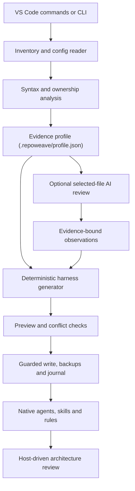

# RepoWeave — Agent Harness Studio

Generate a repository-aware, multi-agent harness for Angular and React projects, from a VS Code extension or a portable Node command-line kit.

*By Roshan Mali*

Version 0.1.0 is a working local preview. It has not been published to the Visual Studio Marketplace.

## Overview

Coding assistants such as GitHub Copilot, Claude Code and Codex work better when they are given accurate, project-specific context: which frameworks and versions are in use, how the workspace is split into projects, how components, services and routes are organized, which styling and test tools exist, and which existing team instructions must be respected. Writing and maintaining that context by hand is tedious, and generic templates often prescribe conventions the project does not follow.

RepoWeave analyzes a repository locally and records what it finds in an evidence profile. From that profile it deterministically generates a complete baseline harness of agents, skills, scoped rules, task prompts and shared context files for the coding hosts you select. Every write goes through a preview, conflict detection and a guarded, journaled apply step, so existing instructions and hand-edited files are never silently overwritten.

RepoWeave is deliberately honest about what static analysis can establish. Business behavior, team precedence and real data flows still need a semantic review. For that step, RepoWeave generates a bootstrap workflow and an `rw-harness-builder` agent that guide your coding assistant through a source-grounded architecture review. RepoWeave itself does not run a background service or autonomous model workers.

## Features

- **Static repository analysis.** RepoWeave inventories first-party files, nested package manifests, Angular workspace and Nx project roots, JSONC configuration and local `tsconfig` inheritance. It resolves framework versions from npm (`package-lock.json`) and pnpm (`pnpm-lock.yaml`) lockfiles.
- **TypeScript AST signals.** The TypeScript compiler API is used to parse JavaScript and TypeScript sources for imports, dynamic imports, Angular `@Component`, `@NgModule` and `@Injectable` metadata (including standalone flags and `providedIn` scope), bootstrap calls, lazy route signals (`loadComponent`, `loadChildren`), React hooks and `'use client'` directives.
- **Per-project ownership.** Each source file belongs to the longest matching project root, so mixed and nested Angular/React projects keep separate profiles. Relative imports are resolved into import edges; unresolved aliases stay unresolved instead of being guessed.
- **No execution of project code.** Analysis never runs npm scripts, imported configuration modules, tests, Git checkouts or remote writes. Scripts are recorded as argument-array descriptors marked `not-run`, and their shell bodies are not copied into instructions.
- **Deterministic generation.** The same profile and options always produce the same files, for one or more of Copilot, Claude Code and Codex, using each host's native agent and skill formats.
- **Safe write model.** Preview with per-file diffs, hash-based conflict detection, managed blocks in root instruction files, backups, a transaction journal, a write lock and rollback on failure.
- **Optional AI review.** Selected files can be sent, after you review the redacted payload, to a model exposed through the VS Code Language Model API. Observations must cite the selected files and stay labeled as unverified suggestions.
- **Optional integration preferences.** Azure DevOps, Jira and Figma preferences enable the corresponding role templates and an MCP onboarding skill. RepoWeave does not install servers, connect accounts or request credentials.
- **Optional freshness hook.** A read-only SessionStart hook can warn when tracked configuration has changed since the profile was generated.

## How it works



1. **Analyze.** RepoWeave builds a file inventory (using `git ls-files` when Git is available, otherwise a filesystem walk that applies nested `.gitignore` rules), reads configuration and parses source syntax.
2. **Profile.** Findings are stored as an evidence profile with file paths, line numbers, coverage counts, omitted files and explicit unknowns.
3. **Preview.** The generator produces the harness in memory. The writer compares each proposed file with what is on disk and the previous manifest, and marks each one as `create`, `update`, `unchanged` or `conflict`.
4. **Apply.** If there are no conflicts and nothing has changed since the preview, the planned files are written.
5. **Review.** Your coding host runs the generated `rw-harness-builder` agent or bootstrap skill to complete the semantic architecture review and refine the harness.

The analysis stages and what each one can and cannot establish:

| Stage | What it does | What it cannot establish alone |
|---|---|---|
| Static scan | File inventory, nested manifests, npm/pnpm resolved framework versions, JSONC and local tsconfig inheritance, Angular workspace roots, decorator metadata, provider scopes, imports, lazy-route signals, React client directives, styles and tooling | Business behavior, library precedence, whether every route really loads lazily, complete API data flow |
| Optional AI review | Sends explicitly selected and reviewed files to a model exposed through VS Code and accepts only observations with valid evidence paths | Whole-repository understanding from a small sample, or guaranteed correct findings |
| Host architecture review | The generated `rw-harness-builder` agent and `rw-bootstrap` skill guide the coding assistant through all first-party areas, real flows, conventions and exceptions | Automatic certification; findings still need project validation |

## Supported targets

Shared context always lives under `.repoweave/`. Each selected host additionally receives native files:

| Target | Agents | Skills (single target) | Rules and instructions |
|---|---|---|---|
| GitHub Copilot | `.github/agents/rw-*.agent.md` | `.github/skills/rw-*/SKILL.md` | `.github/copilot-instructions.md` and scoped `.github/instructions/rw-*.instructions.md`; prompt files in `.github/prompts/rw-*.prompt.md` |
| Claude Code | `.claude/agents/rw-*.md` | `.claude/skills/rw-*/SKILL.md` | `CLAUDE.md` and scoped `.claude/rules/rw-*.md` |
| Codex | `.codex/agents/rw-*.toml` | `.agents/skills/rw-*/SKILL.md` | `AGENTS.md`, which links the shared context; per-project rules are linked from `.repoweave/architecture.md`. No files are written inside application directories. |

When more than one target is selected, skills are written to a single shared location to avoid duplicate names: `.agents/skills/` if Codex is among the targets, otherwise `.claude/skills/`. Each root instruction file links those skill files explicitly. Some clients do not automatically discover another client's skill directory, so in that case follow the linked files. For the cleanest native discovery, select only the host you actively use.

The root instruction files (`.github/copilot-instructions.md`, `CLAUDE.md`, `AGENTS.md`) receive only a small block between `<!-- repoweave:start -->` and `<!-- repoweave:end -->` markers. Text outside that block is preserved.

The shared `.repoweave/` folder contains:

- `profile.json`, the evidence profile, and `architecture.md`, a readable architecture evidence report.
- `commands.json`, a catalog of project scripts as descriptors that analysis never runs.
- `rules/<project-id>.md`, per-project rules derived from the profile.
- `harness.md`, `scan-contract.md`, `BOOTSTRAP.md` and `integrations.md`, the delivery harness, discovery contract, bootstrap workflow and MCP onboarding guide.
- `catalog.md`, `SETUP.md` and `integration-status.json`.
- `prompts/*.md`, plain task prompts for hosts that do not load Copilot prompt files.
- `ai-observations.json`, only when an AI review was run.
- `scripts/freshness.cjs`, only when hooks are enabled.
- `manifest.json` and `backups/`, written by Apply.

## Generated agents and skills

The following agents are always generated:

| Agent | Purpose | Tool access |
|---|---|---|
| `rw-orchestrator` | Coordinates scoped delivery and evidence-based handoffs | Full; can delegate to the other agents on Copilot |
| `rw-planner` | Plans a feature against repository architecture | Read-only |
| `rw-implementer` | Implements scoped application changes following local patterns | Full |
| `rw-ui-specialist` | Implements scoped styling and responsive behavior | Full |
| `rw-test-generator` | Creates missing behavior-focused tests | Full |
| `rw-test-fixer` | Repairs existing tests from observed failures | Full |
| `rw-reviewer` | Reviews a stable diff for correctness and regression risk | Read-only |
| `rw-researcher` | Maps architecture and resolves dependency questions | Read-only |
| `rw-defect-analyst` | Investigates a reported defect and its shared impact | Read-only |
| `rw-pr-reviewer` | Reviews a branch or pull-request diff | Read-only |
| `rw-harness-builder` | Analyzes architecture and refines the generated harness | Full |

Two optional agents are added when integration preferences are selected:

| Agent | Added when | Purpose |
|---|---|---|
| `rw-integration-specialist` | Azure DevOps or Jira is selected | Resolves optional tracker and design context |
| `rw-design-reviewer` | Figma is selected | Compares an implementation against a supplied design (read-only) |

Read-only roles are restricted to read and search tools on Copilot and Claude Code, and request a read-only sandbox on Codex. Enforcement belongs to the host; a Markdown instruction is not an operating-system permission boundary. No model is pinned, so model choice is inherited from the host.

Eight task skills are generated:

| Skill | Purpose |
|---|---|
| `rw-architecture-discovery` | Inspect repository architecture before project-specific generation |
| `rw-bootstrap` | Review repository architecture and complete or refine the generated harness |
| `rw-deliver` | Deliver a feature or defect using the project harness |
| `rw-scaffold` | Create a component or feature matching the target package |
| `rw-test-run` | Execute the relevant configured tests and report failures |
| `rw-quality-review` | Review changed code against local quality rules |
| `rw-system-refresh` | Refresh generated agent knowledge after architecture changes |
| `rw-mcp-onboard` | Connect optional tracker or design context when requested |

Five task prompts are also generated: plan a feature, deliver a feature, review changes, generate missing tests and bootstrap the harness.

## Installation

RepoWeave is distributed as a VSIX file for local installation. It requires VS Code 1.99 or later.

1. Obtain `repoweave-0.1.0.vsix` from the release bundle, or build it from source with `npm run package` (see [Development](#development)).
2. In VS Code, run **Extensions: Install from VSIX...** from the Command Palette and select the file.
3. Open your application repository and make sure the workspace is trusted.

No project dependency installation is needed to use the VSIX, because the extension bundles its scanner libraries. Node.js on `PATH` is needed only for the optional freshness hook and the standalone CLI.

The publisher id `roshan-mali-local` is a local packaging identifier, not a registered Marketplace account. Nothing has been published to the Marketplace.

## Usage in VS Code

1. Run **RepoWeave: Open Harness Studio**, or click **RepoWeave** in the status bar.
2. Choose **Analyze** and review the architecture evidence report.
3. Choose **Preview files**. A summary of proposed changes opens, and you can pick any file to view a before/after diff.
4. Choose **Apply preview** and confirm.
5. Choose **Copy architecture prompt** and paste it into your coding assistant to run the source-grounded semantic review with `rw-harness-builder`.

If the custom agent list does not refresh after Apply, reload the coding client.

All commands are also available from the Command Palette:

| Command | Description |
|---|---|
| **RepoWeave: Open Harness Studio** | Opens the studio panel with all actions and the current analysis and preview status |
| **RepoWeave: Analyze Repository** | Scans the repository and opens the architecture evidence report |
| **RepoWeave: Preview Harness** | Generates the harness in memory and shows proposed changes and diffs |
| **RepoWeave: Apply Previewed Harness** | Writes the reviewed preview after a confirmation dialog |
| **RepoWeave: Analyze Selected Files with AI** | Sends selected, reviewed files to a VS Code language model for evidence-bound observations |
| **RepoWeave: Copy Architecture Review Prompt** | Copies a prompt that starts the bootstrap architecture review in your coding host |
| **RepoWeave: Validate Installed Harness** | Checks installed files against the manifest, their syntax and their cross-references |
| **RepoWeave: Configure Integration Preferences** | Selects Azure DevOps, Jira or Figma preferences for the next preview |

The extension requires Workspace Trust and supports filesystem workspaces, including VS Code remote extension hosts. Virtual workspaces are not supported. In a multi-root workspace, you choose the repository for each command. Changing RepoWeave settings discards the current preview, so preview again before applying.

## CLI usage

The same scan, generate and write engine runs outside VS Code through `scripts/cli.js`. Extract the source package to an external tools folder, or to a dedicated `repoweave-kit` directory under `.github`, `.claude` or `.codex` (the scanner skips `repoweave-kit` directories), and install its runtime dependencies:

```powershell
cd C:\tools\repoweave
npm ci --omit=dev --ignore-scripts
```

The CLI supports four actions:

| Action | Behavior |
|---|---|
| `scan` | Analyzes the project and prints the architecture evidence report. Nothing is written. |
| `preview` | Prints the proposed files and their status (`create`, `update`, `unchanged` or `conflict`) as JSON, plus files retained from earlier targets. Nothing is written. |
| `apply` | Prints the preview, then writes it only when `--yes` is supplied. Conflicts stop the apply before anything is written. |
| `validate` | Validates the installed harness and prints the result as JSON. The exit code is non-zero when validation fails. |

Options:

- `--project PATH` selects the repository. It defaults to the current directory.
- `--target` accepts `copilot` (the default), `claude`, `codex`, `all`, or a comma-separated list such as `copilot,claude`.
- `--hooks` includes the read-only freshness hook.
- `--integrations` accepts a comma-separated list of `azure`, `jira` and `figma`.
- `--yes` confirms `apply`.

Examples:

```powershell
# Print the architecture evidence report
node scripts/cli.js scan --project C:\work\my-angular-app

# Preview a Copilot harness, then apply it
node scripts/cli.js preview --project C:\work\my-angular-app --target copilot
node scripts/cli.js apply --project C:\work\my-angular-app --target copilot --yes

# Preview for every host with the freshness hook and Azure DevOps and Figma templates
node scripts/cli.js preview --project C:\work\my-react-app --target all --hooks --integrations azure,figma

# Validate the installed harness
node scripts/cli.js validate --project C:\work\my-angular-app
```

Run `apply` with the same options you previewed. The CLI uses the default source-file limit of 4,000 files, and it has the same conflict checks as the extension.

A folder of Markdown alone is not a running extension or daemon. The generator must run once, or your coding assistant must execute the supplied architecture-review workflow.

## Settings

| Setting | Default | Description |
|---|---|---|
| `repoweave.targets` | `["copilot"]` | One or more of `copilot`, `claude` and `codex`. Multi-client output uses shared skills to avoid duplicate discovery. |
| `repoweave.includeHooks` | `false` | Adds a read-only SessionStart profile-freshness hook. It is written to `.claude/settings.json` when Claude is a target, otherwise to `.github/hooks/repoweave.json` when Copilot is a target. No Codex hook configuration is emitted. The hook runs no application scripts, makes no network calls and does not write to the workspace. An existing `.claude/settings.json` produces a merge conflict instead of being overwritten. |
| `repoweave.maxSourceFiles` | `4000` | Maximum first-party source files analyzed per scan, between 1 and 20,000. Omitted files are listed in the report. |

Fixed scan budgets also apply. The total inventory is capped at 50,000 files, individual source reads at 512 KiB, and source-content scanning at approximately 32 MiB.

## Safety and write model

- **Preview first.** Apply writes only the reviewed plan. Application source and dependencies are never modified, and writes are restricted to an allow-list of harness paths.
- **Conflict detection.** Generated files are tracked by content hash in `.repoweave/manifest.json`. A file that RepoWeave did not create, or that was edited after generation, becomes a conflict, and Apply stops before writing anything. A managed root block that was changed outside RepoWeave is also a conflict.
- **Drift checks.** Apply rechecks the hashes of scanned inputs, every destination file and the manifest. Any change since the preview invalidates the plan. In VS Code, unsaved editor buffers for affected files also block Apply.
- **Guarded writes.** Apply takes a lock at `.repoweave/write.lock`, backs up prior content and writes a transaction journal under `.repoweave/backups/`, writes each file through a temporary sibling and rename, and writes the manifest last. A failure during Apply rolls back the completed writes.
- **Path safety.** Paths outside the workspace and symlinked paths are rejected. Common secret files such as `.env`, `.npmrc` and private keys are excluded from the inventory.
- **AI boundaries.** AI review is optional and user-initiated. You select the files, inspect the redacted context, and choose a model. Context is limited to 60,000 characters, and redaction is heuristic, not a guarantee. RepoWeave stores no API keys. Observations cannot execute commands or replace files.
- **Refresh.** Run Analyze and Preview again after project changes. Unchanged generated files are updated, and user-edited files are surfaced as conflicts.

Outputs from deselected targets are retained and listed, not deleted automatically. If the process crashes during Apply, inspect `.repoweave/write.lock` and the latest backup journal before recovery. Do not delete the lock blindly.

## Project structure

```text
repoweave/
├── package.json            Extension manifest, commands, settings and scripts
├── src/
│   ├── extension.js        Workspace trust and selection, studio panel, commands, diffs, AI consent
│   └── core/
│       ├── fs.js           Path boundaries, symlink policy, inventory, ignore handling, redaction
│       ├── scanner.js      Manifests, config inheritance, npm/pnpm versions, AST signals, ownership, import edges
│       ├── generator.js    Shared context, native host files, role and skill catalogs, hook opt-in
│       ├── writer.js       Preview, conflict checks, managed blocks, validation, journaled apply and rollback
│       └── ai.js           Bounded selected-file context, prompt and evidence checks for AI observations
├── scripts/
│   └── cli.js              Portable CLI using the same engine
├── resources/
│   ├── roles.json          Agent definitions
│   ├── skills.json         Task skill definitions
│   ├── harness.md          Delivery harness: routes, handoffs, ownership, gates, bounded repair
│   ├── BOOTSTRAP.md        Host-driven architecture review workflow
│   ├── scan-contract.md    Repository discovery contract
│   ├── integrations.md     Optional MCP onboarding guide
│   └── freshness.cjs       Read-only SessionStart freshness hook
├── docs/                   Architecture, comparison, roadmap, sources and validation notes
└── test/                   Node test suite for the core engine and the extension workflow
```

## Development

The extension is written in CommonJS JavaScript and has no build or transpile step. It uses the TypeScript compiler API only to parse target projects.

```powershell
npm ci --ignore-scripts
npm test
npm run check
npm run package
```

- `npm test` runs the Node test suite in `test/`, which covers the core engine and the Analyze, Preview and Apply workflow against a mocked VS Code API.
- `npm run check` performs a syntax check of `src/extension.js`.
- `npm run package` builds the VSIX with `vsce`.

Press F5 in this source project to start an Extension Development Host using `.vscode/launch.json`.

Before any public release, choose a publisher you own, confirm the product name, add repository and support metadata, choose a distribution license and complete real editor testing.

## Limitations and roadmap

- RepoWeave is a local preview. It has not been published, and real VS Code, Copilot, Claude Code and Codex discovery has not yet been verified end to end. The extension test uses a mocked VS Code API.
- There is no background daemon or independent multi-agent scheduler. Agent execution is supplied by the coding host.
- Static analysis does not establish complete business understanding. Semantic review is still needed, and the AI review covers only the files you select.
- TypeScript path aliases are listed from configuration but not resolved in the import graph. Package-based `tsconfig` inheritance, decorator namespace imports and complex computed metadata may stay unresolved. Angular implicit standalone behavior is only inferred when the Angular version is resolved from a lockfile.
- Hooks are preview features in some hosts, and no Codex hook configuration is emitted in this version.
- MCP connections and authentication happen in the host. There is no built-in Jira, Azure DevOps or Figma client.
- Existing Claude settings need a manual hook merge, and conflicts need deliberate resolution. Automated crash recovery and removal of obsolete target files are not implemented.
- Windows-specific edge cases and real editor interactions still need testing.

See [docs/ROADMAP.md](docs/ROADMAP.md) for the full capability status and prioritized next work.

## Documentation

- [Architecture](docs/ARCHITECTURE.md): pipeline, modules, ownership model, write model, tool permissions and AI boundaries.
- [Comparison](docs/COMPARISON.md): review of earlier kits and the design decisions retained or corrected.
- [Roadmap](docs/ROADMAP.md): implemented capabilities, practical limits and next releases.
- [Validation](docs/VALIDATION.md): what the automated tests cover and what has not been tested.
- [Sources](docs/SOURCES.md): official API and format references used during implementation.

## Author

RepoWeave is created and maintained by **Roshan Mali**.

## License

Copyright (c) 2026 Roshan Mali. All rights reserved.

This preview is supplied for the owner's evaluation and development and is not released under an open-source license. A distribution license will be chosen before public release. Third-party dependencies retain their respective licenses. See [LICENSE](LICENSE).
