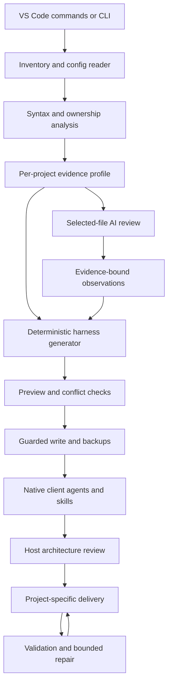

# RepoWeave architecture

The loop at the bottom is executed by the coding host under the generated harness. RepoWeave does not spawn autonomous model workers behind the editor.

## Modules

| Module | Responsibility |
|---|---|
| `src/extension.js` | Workspace selection/trust, studio, commands, preview diffs, model selection and consent |
| `src/core/fs.js` | Path boundaries, no-symlink policy, inventory, ignore handling and heuristic redaction |
| `src/core/scanner.js` | Manifests, local config inheritance, npm/pnpm framework versions, AST signals, package ownership, import edges (relative, tsconfig `paths` and `baseUrl`), route and main-file facts, and per-project `stack` facts |
| `src/core/template.js` | Placeholder renderer and profile-to-placeholder context. `generate()` renders `resources/templates/` |
| `src/core/semantic.js` | Loads optional `.repoweave/semantic.json`, validates it, and escapes its text. RepoWeave never writes that file |
| `src/core/prefix.js` | Derives and checks the agent-name prefix |
| `src/core/generator.js` | Template-backed agents, skills, instructions and prompts for Copilot, Claude and Codex, plus hook opt-in |
| `src/core/writer.js` | Preview, ownership checks, managed blocks, syntax/reference validation, journaled apply and rollback |
| `src/core/ai.js` | Bounded selected context, prompt and schema/evidence checks on AI observations |
| `resources/` | Architecture review and delivery harness content. `resources/templates/` supplies the agent, skill, prompt and instruction bodies |
| `scripts/cli.js` | Same scan/generate/write engine outside VS Code |

## Ownership model

Each source file belongs to the longest matching project root. Nested Angular/React projects retain their own profiles. Configuration packages may declare tooling used by several applications; a declaration is distinct from a source import. Relative imports and local tsconfig `paths` / `baseUrl` aliases resolve into edges. An alias that does not match a local file stays unresolved. Package-based tsconfig `extends` is not followed.

## Write model

Preview captures destination text and hashes of inspected source/config inputs. Apply rechecks both, rejects conflicts, acquires a lock, backs up prior content, writes with temporary siblings and rename, and writes the manifest last. Runtime failures trigger rollback of completed writes. A process crash can leave a lock and prepared journal; manual recovery is documented and automated crash recovery is future work.

## Tool permissions

Read-only Claude roles omit Bash/Edit/Write. Read-only Codex roles request a read-only sandbox. Copilot reviewers use read/search tools. Actual enforcement belongs to the host; a Markdown instruction is not an operating-system permission boundary. No approval policy or global tool configuration is weakened by this extension.

## AI boundaries

Static analysis is local. An AI request is optional and user-initiated. The user selects files, reviews the redacted payload, then chooses a model exposed through the VS Code Language Model API. No API key is stored by RepoWeave. Observations must cite selected paths, remain inferred and are emitted separately; they cannot execute commands or arbitrarily replace files.
